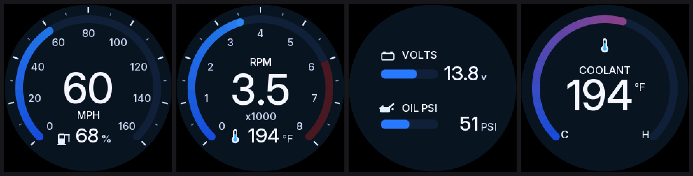

# gauges-fw (S32K144: boots to main in the image, drivers still stubs)

Target: NXP S32K144, 64-LQFP, on `../../gauges`. Pin numbers below come from the gauges schematic comments (which were read from NXP's S32K1xx IO table); `inc/gauges_pins.h` is the single place they live.

## Layout (follows `../../../ecu-firmware`: inc/, src/, test/)

| File | Job | State |
|---|---|---|
| `src/main.c` | init order and a 10 ms scheduler loop | stub |
| `src/aggregate.c` | source priority: Hall vs car-bus speed, tach vs car-bus RPM, car vs local fluids | **real, tested** |
| `src/senders.c` | resistive fuel / oil / coolant / battery ADC to engineering units | stub, needs measured sender curves |
| `src/inputs.c` | FTM1 capture for speed (CH4) and tach (CH5), six lamp GPIOs, dimmer ADC, ignition wake | stub |
| `src/can_link.c` | CAN0 (car bus, listen-only) and CAN1 (private link) with counter + CRC-8 from `cluster_can.h` | stub |
| `src/gfx.c`, `inc/gfx.h` | tile renderer for the 240x240 round screens: anti-aliased arcs, capsules, discs and 5x7 glyphs from a short op list, integer inner loops, no framebuffer (one frame is 115 KB, the part has 60 KB of RAM) | **real, tested** |
| `src/dial_modern.c` | the **modern theme**: dark navy face, thick progress arcs filling blue (to red), big proportional digits, small icons, two horizontal bars for volts and oil, modelled on the owner's reference picture | **real, tested**; styling a first pass |
| `src/dial_carplay.c` | the **carplay theme**: Apple-inspired (black face, thin rings, white knob, system colours, two concentric rings for volts and oil); shares the arc themes' change tracking with dial_modern.c | **real, tested**; styling a first pass; whether the product may call it CarPlay-styled is a licensing question (B5) |
| `src/dial_factory.c`, `src/face.c`, `src/face_data.c` | the **factory theme**: printed 1966 Mustang gauge faces (generated pictures) with needles drawn over them | **real, tested**; faces drawn by eye from photos, a first pass to tune |
| `src/font_data.c`, `inc/font.h`, `tools/gen_font.py` | anti-aliased bitmap fonts (60 px digits, 28 px and 15 px text) generated from Inter (SIL Open Font License, `../../docs/fonts/OFL-Inter.txt`); the generated C is committed, Pillow is only needed to regenerate | generated |
| `src/dial.c`, `inc/dial.h` | one screen's picture (scale, ticks, labels, red zones, needle, seven-segment digits, unit, small readout) built from a `screen_view_t`, and the change tracking: which 8x8 tiles differ from what is on the panel | **real, tested**; the styling is a first pass to tune with the owner |
| `src/gc9a01.c`, `inc/gc9a01.h` | GC9A01 driver: init sequence, window, RGB565 blit | **real, tested against a mock panel**; init values partly from an open-source driver, see below |
| `src/aux_display.c` | four screens: reset, init, first frame, then send only the changed tiles, a bounded number per tick | **real, tested** |
| `src/panel_hal_s32k.c` | LPSPI2 + GPIO bus layer for the four screens (blocking, polled, 9.6 MHz) | written from the RM, **compiled and linked, never run on a part** |
| `test/panel_mock.c` | mock of four GC9A01 panels: decodes the SPI stream, models the GRAM window, flags protocol mistakes | test tool |
| `src/power.c` | STOP mode, ignition wake, `PowerState` message | stub |
| `src/startup.c`, `src/vectors.c`, `src/fcf.c`, `link/s32k144.ld` | reset path (SRAM ECC zero-fill, watchdog off, .data, FPU), generated 139-entry vector table, flash configuration field at 0x400, linker script | **real, built and linked; not run on a part** |
| `src/clock.c`, `src/tick.c` | 8 MHz crystal to SPLL to 80 MHz core, 10 ms SysTick, `now_ms()` | **real, not run on a part** |
| `inc/s32k144_regs.h`, `inc/s32k144_irq.h` | register layer written from the RM (each block cites its section); IRQ numbers generated by `tools/gen_vectors.py` | real |
| `src/screens.c` | what each small screen shows: speed, rpm, fuel, volts, coolant, oil as needle fraction, number, unit, warning (imperial or metric); default layout fuel+volts / speed / rpm / coolant+oil | **real, tested** |
| `test/test_*.c` | host unit tests (aggregate, inputmath, codec, screens, gfx, dial, gc9a01) | real |

## Rules this firmware must keep
- CAN0 stays in **listen-only**: gauges/ never transmits on the car bus.
- Every private message carries a rolling counter and CRC-8 (SAE J1850, 0x1D, init 0xFF, xorout 0xFF) exactly as `cluster_can.h` defines.
- Each value carries a valid flag and a source; stale car-bus data (older than `CLUSTER_CAR_BUS_TIMEOUT_MS`) falls back to the local sender.
- Display liveness: no `DisplayHeartbeat` for `CLUSTER_DISPLAY_TIMEOUT_MS` sets `DisplayOffline`, but gauges/ keeps running.

## Toolchain
`arm-none-eabi-gcc` 12.3 (installed in WSL for the AAOS build, see `../PLAN.md`), no NXP SDK. In WSL:

```
make test       # host tests (gcc)
make arm-check  # compile every file for the Cortex-M4F, -Werror
make arm        # link build/gauges-fw.elf with link/s32k144.ld
sh tools/inspect_elf.sh   # vector table, flash config, reset code
```

Verified by inspection of the linked image only (SP 0x20007000, reset vector 0x411, SysTick at vector 15, flash configuration 0xFE/0xFB at 0x40C/0x40D). **Nothing has executed on a part.** `FSEC` is left unsecured for debugging; production must secure it.

## The four screens (A7)

Four themes, chosen by the user (`DisplaySettings.GaugeTheme` in the protocol; the Android settings list sets it, the harness key T switches it locally). A theme brings its own layout (`screens_layout()`): **classic** is needles on 270 degree scales with seven-segment digits (fuel + volts, speed, rpm, coolant + oil); **modern** follows the reference picture (speed with fuel, rpm with coolant, volts and oil as two bars, coolant); **carplay** (added 2026-10-16) is Apple-inspired: black face, thin rings with a white knob, system colours, volts and oil as two concentric activity-style rings. The Android app switches the small screens to it automatically while a phone shows CarPlay (setting "With CarPlay", on by default), and back afterwards; Android Auto and no phone keep the user theme. **factory** (added 2026-10-16) copies the 1966 Mustang's own gauges: fuel (with a small volts readout), speedometer (MILES or KM/H, radial numerals), oil and temperature, black printed faces with a red-orange needle; no tachometer (the stock cluster has none) and an empty odometer window. The printed faces are pictures made by `tools/gen_faces.py` (condensed Inter, run-length coded 4-bit, `src/face_data.c`), the needles are drawn by `src/dial_factory.c`. Previews rendered through the real driver into the mock panel are in `docs/screens/` (`make preview PRESET=1 UNITS=metric THEME=modern` style: `./build/preview <preset> <imperial|metric> <classic|modern|carplay|factory>`, then `python tools/montage.py out.png`). Unknown theme numbers show classic.



**The bus is the limit.** The S32K144 datasheet limits LPSPI to 10 MHz in Run mode (quoted for Rev 13 on NXP's forum; check the current table), so the HAL runs 9.6 MHz (48 MHz FIRC / 5). At that rate a full 240x240 frame is 96 KB, 80 ms: too slow to redraw, so nothing is redrawn whole. Numbers from `make test` and `make bench` (operations counted, not timed):

| | per screen | on the bus at 9.6 MHz |
|---|---|---|
| first full draw | 764 tiles, 96 KB | about 80 ms (all four: about 0.3 s, once at boot) |
| a small move (needle 1 degree, a digit changes) | 50 to 70 tiles, 6 to 9 KB | 5 to 7 ms |
| a large move | 70 to 100 tiles, 9 to 12 KB | 8 to 10 ms |
| nothing visible changed | 0 | 0 |

Four screens updating 15 times a second is about 3.5 Mbit/s, roughly a third of the bus. Tricks used: tiles are 8x8; only the tiles under the old and new needle are resent; only the digits that changed are resent; the needle moves in whole degrees; rpm is shown to the nearest 10. CPU cost per small update is about 2 to 3 ms (operation counts times an **assumed** cost per operation: not measured on hardware). The SPI transfers block the CPU; DMA would free it and is the next optimisation.

**Test harness (`test/harness.c`, `make harness` / `make harness_cli`).** One native program that runs the real screen code (screens, dial, gfx, driver, scheduler) in the firmware's loop shape against the mock panel, so a styling or timing change is seen or measured in seconds. `tools/run_harness.ps1` builds it, opens the window (an X11 window shown on the Windows desktop by WSLg; the X11 headers are unpacked once into `~/x11sdk` by `tools/get_x11_headers.sh`, no root needed) and points the Android app at it. Without a window (`build/harness_cli`, no display needed) the same program does the automated work:

| Command | What it does |
|---|---|
| `harness` | window with the four round screens (T switches theme) and a status area drawn with the firmware's own font. Keys: SPACE pause, D built-in drive, M manual (arrows = speed and rpm, F C O B = fuel, coolant, oil, battery, 1-6 toggle an input valid/invalid), A Android, R replay, U units, TAB zoom, S save a PNG, Q quit |
| `harness --udp 5005` | listen for the Android app's telemetry line (UDP); no data for 1 s shows dashes, like the firmware. `--record f` saves what arrives, `--replay f` plays it back |
| `make golden` | 11 fixed states x 4 screens against stored checksums (`test/golden_screens.txt`). A one-bit colour change or a moved label shows up as CHANGED; look with `make golden-dump` (PNGs in `build/golden`), accept with `make golden-update` |
| `make sim` | 60 virtual seconds of driving with unit switches: bus load, worst tick, backlog, time to redraw after a switch, and whether the panel equals the model at the end. Fails if any tick needs more than 10 ms of bus time |
| `harness --selftest` | panel equals model through a drive (with a unit switch), lost data gives dashes, CRC and PNG helpers |
| `harness --shot f.png --after 5` | run, then save the window picture (works without a display) |

What the harness found that the unit tests had not (it is the loop shape and the load that matter): with the old "12 tile runs per tick" limit the screens always had tiles waiting and a unit switch could need 12.8 ms of bus time in a 10 ms tick. The scheduler now has a byte budget (`aux_display_poll_budget`, 8000 bytes per tick): steady driving keeps up (on average 1 tile waiting, 95th percentile 8), no tick exceeds 9.9 ms of bus time at 9.6 MHz, and a unit switch (about 3000 tiles) settles in 380 ms.

The Android side of the feed: the app sends its vehicle state as one UDP line every 50 ms (`../android/cluster-app`, `Telemetry`), by default to `10.0.2.2:5005` (the PC); `run_harness.ps1` redirects it to WSL's address with the `telemetry` broadcast extra. In the car the data flows the other way (the gauges board is the source).

**Modern theme cost.** Redrawing big digits and arc ends on every wobble of the data took 35 % of the bus, so the modern dial follows the arc in whole degrees and refreshes the numbers at most every 80 ms (`AUX_TEXT_HOLD_TICKS`; a big jump, a warning or a change of validity goes through at once): 14 % on average, 50 % peak over a simulated drive.

**Verification.** The property test replays 720 random updates (all four layouts, both unit systems, valid and invalid inputs) and requires the patched panel to equal a full redraw and equal a render straight from the model; twelve deliberate breakages of the tile marking and the rasteriser are each caught. The mock panel enforces the GC9A01 protocol: chip select framing, the FEh/EFh unlock before level-3 registers, COLMOD before pixel writes, 5 ms after Sleep Out, no display-on too early, no pixels outside the window. `tools/check_vendor_block.py` re-derives the register tables from the open-source reference and compares them byte for byte; `tools/check_pins.py` checks the HAL's pins against `gauges_pins.h`.

**Not verified, and why (needs hardware or Raystar):**
- The init sequence. Documented commands come from the GC9A01 datasheet; the block of undocumented registers (84h-8Fh, 90h, ..., 98h) and the default power, gamma and frame-rate values are from Zephyr's driver (`display_gc9x01x.c`, Apache-2.0), which says they come from manufacturer sample code. **Raystar's RFA401280B-AYW-DNF1 may need other values: ask Raystar for their init code** (`../../docs/rfq-drafts.md`, section 5).
- Orientation (`GC9A01_MADCTL`), RGB/BGR order and display inversion (`GC9A01_INVERT`) for this module.
- The LPSPI limit and the HAL (clock source, FIFO use, byte swap, frame sizes) on a real part.
- Boot: about 0.3 s of waits plus the first draw before the screens turn on; the 150 ms after Sleep Out is the open-source driver's margin (the datasheet requires only 5 ms).

## Not decided yet
- 80 MHz RUN is configured; 112 MHz HSRUN is not needed yet.
- Final watchdog policy (it is disabled at boot with UPDATE=1 so it can be reconfigured; decide with the STOP-mode work).
- Sender curves (measure the real fuel / oil / coolant senders).
- Debounce and polarity policy per lamp channel (`InputConfig.LampInvertMask`).
