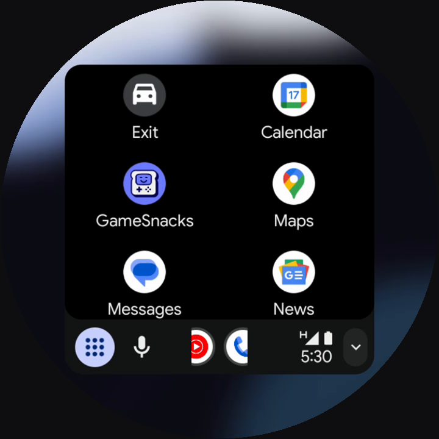
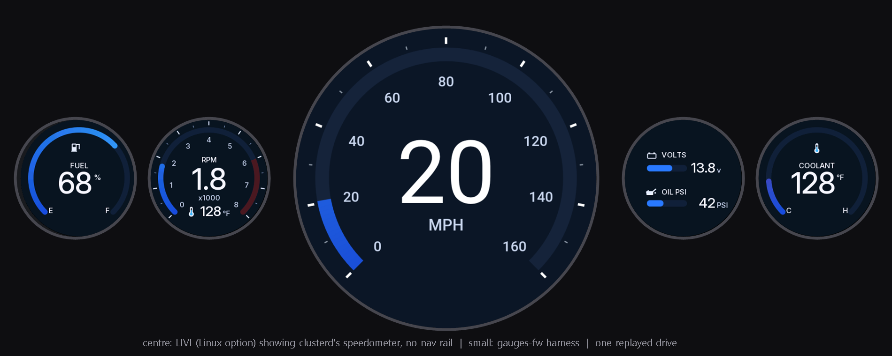

# Bench: Android Auto into LIVI with no car, and clusterd with no hardware

## clusterd against a stand-in LIVI (works today)

`bench_clusterd.sh` runs clusterd with no CAN and a scripted dial, and `fake_livi.py` in place of LIVI
(its telemetry endpoint and its `state/status.json`). It checks the page changes, the telemetry pushes, the
dial going to the phone as knob keys, Settings on a long hold, and the settings page server. 11 checks pass
in WSL Ubuntu 22.04.

## Android Auto from an emulator (the owner has an iPhone)

**Can an emulated Android phone drive LIVI? In principle yes, with two unknowns.**

Why it can work: Android Auto's developer settings have a **head unit server** (Android Auto app: tap the
version 10 times for developer mode, then the overflow menu, *Start head unit server*). It listens on TCP
5277 on the phone; Google's Desktop Head Unit reaches it through `adb forward tcp:5277 tcp:5277`. LIVI's
wireless Android Auto listens on TCP 5277 as well (the phone connects to it after the Bluetooth bootstrap).
After the TCP connection the protocol is the same in both directions, and the head unit is the TLS client
either way (LIVI `livi-aa/src/tls.rs`), so `relay.py` connects to both listeners and copies bytes.

```
Android emulator (Google Play image) or a real Android phone on USB
   │  head unit server :5277
   │  adb forward tcp:5277 tcp:5277
   v
relay.py --phone 127.0.0.1:5277 --livi 127.0.0.1:5278
   v
LIVI (LIVI_PORT=5278) on Linux
```

The unknowns, in the order they would bite:

1. **Android Auto inside an emulator.** It needs a Google Play system image and the Android Auto app from the
   Play Store, which needs a Google sign-in (the owner signs in; an agent must not). Google's own testing
   guidance points to a real phone; nothing found says Android Auto runs or refuses to run in an emulator.
   **First experiment**: install it on an emulator and see whether developer mode and the head unit server
   appear. Then check it with Google's Desktop Head Unit before involving LIVI at all.
2. **LIVI only opens its Android Auto port once Bluetooth is up** (`linux_main.rs`: the TCP listener is
   started inside the Bluetooth set-up). WSL has no Bluetooth adapter, so on WSL the port never opens. Options:
   a Linux PC or a Raspberry Pi 5 with Bluetooth (the listener then opens even though the phone never uses
   Bluetooth), or a one-line change to start the listener without Bluetooth (an upstream issue or patch).
   LIVI's AppImage is also tested on Debian Trixie / Ubuntu 26.04 and WSL here is Ubuntu 22.04, which is
   probably too old for it.

**A borrowed Android phone removes unknown 1** and works the same way through `adb forward`.

## Result, 2026-10-17: Android Auto from an emulator, projected by LIVI, driven by clusterd



End to end on one Windows PC, no phone and no hardware:

| | Evidence |
|---|---|
| Android Auto 18.0 on the emulator talks to LIVI: TLS up, protocol 6.1, phone `sdk_gphone64_x86_64`, H.264 video | LIVI log; `shots/android-auto-in-livi.png` (live Google Maps in LIVI's window) |
| LIVI with `livi_config.py --shape 0`: 720 x 720, safe area 106 px; Android Auto lays itself out inside the circle | `shots/android-auto-round.png` (the window through a round mask) |
| clusterd `--replay` (the can_replay.py drive, through the real vhal-bridge decoder) to LIVI telemetry, and to **our speedometer** on LIVI's custom page in all four themes | LIVI's `state/vehicle.json` (fuel 67.9 %); `shots/centre-classic-in-livi.png`, `centre-modern-in-livi.png`, `centre-carplay-in-livi.png`, `centre-factory-in-livi.png` |
| A 1.6 s dial hold (`--dial-stdin` from a pipe): clusterd tells LIVI to open `/custom`, the Settings list on the same page | `shots/clusterd-settings-in-livi.png`; LIVI status.json `ui.path` = `/custom`, back to `/` after a hold |

How the emulator got the real Android Auto (the Play Store refuses it there): the owner downloaded the
Android Auto bundle (18.0.664204, arm64-v8a, .apkm) from APKMirror; `adb install-multiple` of `base.apk`,
`split_config.arm64_v8a.apk`, `split_config.en.apk` and `split_config.xxhdpi.apk`. Android accepted it as an
update of Google's preinstalled stub, which it only does for the same signing lineage, so the file is
Google-signed. The x86_64 emulator image runs arm64 code (`ro.product.cpu.abilist` = x86_64,arm64-v8a).
Then, all in the emulator: Android Auto settings, tap Version ten times, allow development settings, ⋮ >
Start head unit server; `adb forward tcp:5277 tcp:5277`; `relay.ps1`.

First-run consent (the owner agreed to it): tapping Continue was not enough, because the permission prompts
timed out. What worked: `pm grant` of Android Auto's 14 runtime permissions, notification access with
`cmd notification allow_listener 'com.google.android.projection.gearhead/com.google.android.gearhead.notifications.SharedNotificationListenerManager$ListenerService'`
(quote the `$`), location for Maps, then a fresh session.

Traps:
- **The phone's head unit server wedges** when the head unit vanishes mid-session (a killed DHU, a LIVI
  restart). LIVI then logs "stuck in state INIT ... phone-side AA service likely zombie". Fix: force-stop
  Android Auto, open its settings, start the head unit server again.
- **LIVI offers H.265 only** when it can decode H.265 in software and has no H.264 hardware decoder, and the
  emulator cannot encode H.265 ("no working configuration" in logcat). `LIVI_AA_H264_ONLY=1` (the patch).
- WSL's kernel has no virtual CAN (`CONFIG_CAN_VCAN` not set), hence clusterd's `--replay` bench input.

Findings for the round panel (open):
- **LIVI's own pages have a navigation rail** down the left edge; on the round glass its top and bottom icons
  fall outside the circle. **Resolved for our page**: `../livi/livi-round-ui.patch` adds a LIVI setting
  `customHideNav` (set by `livi_config.py`); with it the custom page, our speedometer and settings, fills the
  window with no rail and no clock. LIVI's own settings and media pages keep the rail (not driver screens).
- **LIVI's default dashboard is landscape** (two dials side by side) and cut on 720 x 720. **Resolved**: the
  gauge view is our own speedometer on the custom page (web/centre.html), not LIVI's dashboard.
- **Fonts**: the page asks for Roboto / Roboto Condensed like the Android app. Without them Chromium falls back to
  DejaVu Sans, which is so much wider that the factory face's 100-140 numerals run into each other. The image
  needs `fonts-roboto` (checked on the bench: installed, LIVI restarted, the numerals space out).
- **With a phone connected the dial cannot reach the gauge view**: on the maps the dial belongs to the phone,
  and Settings returns to the maps. hmi.h's flows need a way to the gauge while projecting (a Settings row,
  or a longer hold). A UX decision for the owner.
- LIVI's dashboard read coolant 0 degrees during the replay; not checked (that dashboard is no longer our gauge,
  but the coolant value also goes to Android Auto and CarPlay, so it is worth a look).

## The whole cluster on one PC



`clusterd --harness-udp 127.0.0.1:5005` also sends the Android app's telemetry line (`CL1 ...`, core/Telemetry.java)
to gauges-fw's host harness (`build/harness --udp 5005`), so one replayed drive moves LIVI's centre and the four
small gauges (the real firmware drawing code) together, with the same theme, units and "centre shows speed".

Building LIVI's UI with the round patch, in the bench distro: Node 24 from nodejs.org (checksum-checked),
`ELECTRON_SKIP_BINARY_DOWNLOAD=1 pnpm install --frozen-lockfile`, `pnpm run build:app`; then extract the
AppImage's `resources/app.asar` (`npx @electron/asar extract`), replace its `out/` with the new one, pack it
back, and drop in the rebuilt `livi-core` and `livi-helperd` (the config struct changed). The repacked archive
has the same 41,562 entries; only `out/` differs.

## What the bench run on 2026-10-17 found first

- **The Play Store route is closed.** The Google Play phone image (Android 15, `system-images;android-35;google_apis_playstore;x86_64`)
  ships Android Auto only as a stub (`1.2.542030-stub`); the Play Store then refuses the real app with
  "This app isn't compatible with your device anymore". Sideloading the Google-signed bundle (above) works.
- **LIVI side: works, with the steps below** (all in a separate WSL distro, Ubuntu 24.04, run as root):
  - LIVI 9.5.0's binaries need glibc 2.39 (Ubuntu 22.04 has 2.35, too old).
  - Its compositor and GStreamer needed `libwayland-server0` and the GStreamer base libraries from apt.
  - Its bundled FFmpeg needs `vaMapBuffer2` (libva 2.21+) and its bundled waylandsink needs
    `wl_display_create_queue_with_name` (libwayland 1.23); Ubuntu 24.04 has 2.20 and 1.22, so libva 2.22.0 and
    wayland 1.23.1 were built from source into /usr of the bench distro. LIVI's core sets the decoder's
    LD_LIBRARY_PATH itself, so an LD_LIBRARY_PATH from outside does not reach it. Then delete
    `~/.cache/gstreamer-1.0` (it remembers plugins that failed to load). Result: `h264 sw: true`.
  - `livi-tcp-without-bt.patch` applied to LIVI's dev branch at b43c7153 (the nightly's own commit), only
    `livi-helperd` rebuilt (`cargo build --release -p livi-helperd`, 2 min 16 s) and dropped into the extracted
    AppImage's `resources/driver/`. With `LIVI_AA_TCP_WITHOUT_BT=1 LIVI_PORT=5278` LIVI logs
    `[aa-tcp] listening on 5278`, and the port is reachable from Windows (where adb and the relay run).
  - LIVI probes the Apple coprocessor at 0x10 / 0x11 on I2C bus 2 at start-up and says none answered, as expected.
  Debian Trixie (libva 2.22, wayland 1.23) would avoid the two source builds.

## CarPlay on the bench

No emulator route: the iPhone needs the Apple authentication coprocessor on the head unit for wired and
wireless CarPlay alike (LIVI: "cannot be emulated"). With a coprocessor on an I2C bus, a Linux PC or Pi
running LIVI takes the iPhone over USB.

## Downloads this would need (not done; ask first)

| What | From | Size |
|---|---|---|
| LIVI-9.5.0-linux-x86_64.AppImage | github.com/f-io/LIVI releases | about 242 MB |
| Android emulator system image, Google Play, x86_64 | Google, through the SDK manager | about 1.5 GB (estimate) |
| Debian Trixie for WSL (if the AppImage will not run on Ubuntu 22.04) | Microsoft Store / Debian | about 100 MB |
